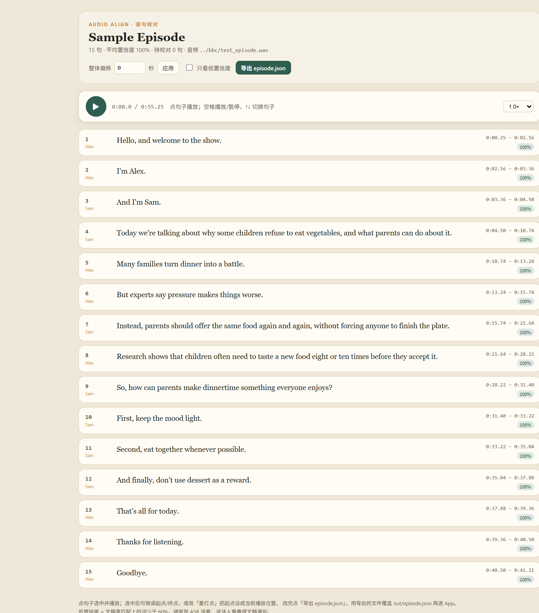
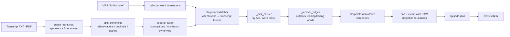

# audio-transcript-align

> Turn a podcast MP3 + transcript into sentence-level timestamps, a clean JSON, and a browser QA page.

把「整段音频 + 文字稿」对齐成逐句时间轴。输出 `episode.json` + 可点的 `preview.html`，给逐句循环、遮蔽、听写、跟读、单句字幕用。

BBC Learning English 是参考场景（它的文稿不是逐字稿），但播客、讲座、网课、自己录的课都能用。



*示例数据为合成英文对谈，不是 BBC 内容。*

## 为什么需要它

有音频和文稿，但没有时间轴，就只能整段播。要做逐句听写，至少需要三样：

1. 每句的 `start/end`（句级时间戳）
2. 句子文本 + 说话人
3. 一个能快速校对边界的页面

难点不是 ASR，也不是播放，而是**文稿和音频不是一一对应**。BBC 6 Minute English 的文稿开头就写着 `Note: This is not a word-for-word transcript.`：音频里有 filler、口误、重复，文稿是清理过的。所以这个项目只做**句级**对齐，不做词级卡拉 OK；听写只判 1–2 个目标词，不判整句默写。

## 快速开始

### 1. 环境

- Python **3.10–3.12**（3.14 没有 `ctranslate2` 轮子）
- 可选：`pdftotext`（PDF 文稿）、`ffmpeg`（转码）

```bash
python -m venv .venv
# Windows
.venv\Scripts\activate
# macOS / Linux
source .venv/bin/activate

pip install -r requirements.txt
```

### 作为 Python 包安装（推荐）

```bash
pip install -e ".[dev]"
pytest
audio-align --help
```

安装后会多一个 `audio-align` 命令，参数与 `python audio_align.py` 完全一致。
仓库里的 `data/` 已加入 `.gitignore`，可以放自己的音频/文稿，不会被提交。

### 2. 准备文稿

网页复制成 `txt` 即可；PDF 建议用 **layout 模式**：

```bash
pdftotext -layout -enc UTF-8 ep.pdf ep.txt
```

> 不要用 plain 模式：它会把 `Alex Hi Sam.` 并成一行，说话人识别不出来。

脚本会自动处理：

- `TRANSCRIPT` 之后的正文（之前是标题、问题、词汇表）
- `**Alex**`、`Alex:`、单独一行 `Alex`、`### Alex`
- 页脚 `©British Broadcasting Corporation`、`bbclearningenglish.com`、`Page N of M`
- 在 `VOCABULARY` 处停止

### 3. 跑对齐

```bash
python audio_align.py \
  --audio ep.mp3 \
  --transcript ep.txt \
  --out out \
  --title "Episode title" \
  --model base.en
```

国内下载模型：

```powershell
$env:HF_ENDPOINT = "https://hf-mirror.com"
```

脚本默认设置 `HF_HUB_DISABLE_XET=1`（Xet 在某些网络会卡在 0 字节）。如果 HF 仍然 SSL 断流，手动下 4 个文件到一个目录，然后：

```bash
python audio_align.py ... --model /path/to/faster-whisper-small.en
```

模型选择：

| 模型 | 大小 | 6 分钟音频（CPU int8，已缓存） | 适合 |
|---|---|---|---|
| `base.en` | 145 MB | ~1 分钟 | 先跑通、快速看结果 |
| `small.en` | 462 MB | ~1–2 分钟 | 正式用；非逐字稿更稳 |
| `medium.en` | 1.5 GB | 更慢 | 口音重/噪声大 |

### 4. 输出

```text
out/
├── episode.json      # 每句 start/end + confidence
├── preview.html      # 浏览器打开，逐句播放/微调/导出
└── asr_words.json    # Whisper 原始词级时间戳，排查用
```

`episode.json`：

```json
{
  "version": 1,
  "title": "Episode title",
  "audio": "ep.mp3",
  "duration": 41.0,
  "language": "en",
  "model": "small.en",
  "stats": {
    "sentences": 15,
    "low_confidence": 0,
    "mean_confidence": 1.0
  },
  "sentences": [
    {
      "i": 0,
      "speaker": "Alex",
      "text": "Hi Sam.",
      "start": 0.0,
      "end": 0.81,
      "confidence": 1.0,
      "needs_review": false
    }
  ]
}
```

### 5. 校对页

`preview.html` 直接用浏览器打开（`file://` 即可）：

- 点句子播放；空格暂停；↑↓ 切换句子
- 选中行：起点/终点 `±0.1s`、`重打点`（把起点设为当前播放位置）、`删除本句`
- 整体偏移 `±N 秒`
- 只看低置信度
- 导出 `episode.json`（覆盖原文件即可）

短句用 `requestAnimationFrame` 检查播放位置，0.27 秒的 `Is it:` 也能停在 `end`，不会拖到下一句。

## 桌面版（Windows）

不想用命令行时，有一套 PySide6 单窗口版：选音频/文稿/输出目录 → 进度 → 完成 → 内置校对台。

```bash
pip install -r requirements-desktop.txt
python run_desktop.py
```

打包成 exe（PyInstaller onedir + 内置 small.en）：

```bash
python tools\build_desktop.py --zip
```

产物在 `dist/AudioAlign/`，绿色 zip 在 `dist/AudioAlign-win64.zip`。详细结构与构建说明见 **[docs/desktop.md](docs/desktop.md)**。

## 实现流程



详细实现和复盘见 **[docs/implementation.md](docs/implementation.md)**。

核心文件：

| 文件 | 作用 |
|---|---|
| `audio_align.py` | CLI + 文稿解析 + 分句 + 归一化 + ASR + 对齐 + 校对页（单文件，约 1100 行，其中约 300 行是对齐核心） |
| `tests/test_audio_align.py` | 9 条纯逻辑单测，不需要模型和音频 |
| `examples/sample_transcript.txt` | 合成示例文稿（不是 BBC 内容） |
| `examples/sample_asr_words.json` | 合成词级时间戳，可配合 `--asr-json` 做干跑 |
| `docs/preview.png` | 校对页截图（合成数据） |

## 真实数据实测

用一期 6:28.82 的 BBC 6 Minute English（音频和文稿**不进仓库**）：

| 模型 | 句子 | 平均置信度 | 待校对 | 备注 |
|---|---|---|---|---|
| `base.en` | 76 | 0.979 | 1 | 把一段 6 秒的过渡句吞成一个 `from`，那段边界错 |
| `small.en` | 76 | **0.993** | **0** | 全部句子有 ASR 词覆盖；0 处切首词/切末词 |

自动检查：76 句每句 `start/end` 内至少有一个 ASR 词；没有 `start` 晚于首词、`end` 早于末词的情况；只有 1 个 ASR 词落在句间（过渡碎片）。

## 限制

- **只做句级**：非逐字稿做词级高亮一定漂；不要拿它做卡拉 OK。
- **不做说话人分离**：说话人来自文稿，不是 diarization。
- **不做翻译/释义**：只输出时间轴和文本。
- **没有内置音频**：仓库不含 BBC 音频/文稿；请自备本地文件。
- **单文件脚本**：为了好复制；要长期维护可以拆成 `parse / align / preview` 三个模块。

## 版权

BBC Learning English 的下载条款是 personal / educational non-commercial use。本项目只处理**你本地已有的**音频和文稿，不抓站内、不打包、不分发。仓库里的示例文本和截图均为合成内容。

## 测试

```bash
python tests/test_audio_align.py -v
```

9 条测试覆盖：缩写/小数点/引号分句、`**Name**` / `Name:` / 裸名字 / `### Name`、前置内容和 `VOCABULARY`、省略号碎片合并、缩写/数字/千分位/域名归一、重复短语聚簇、端到端 `--asr-json`。

## License

MIT
